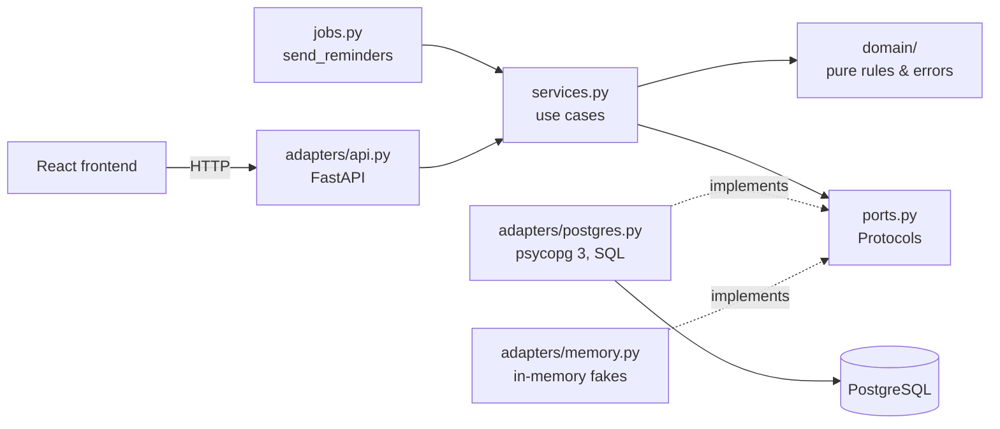

# Classroom Booking System

[](https://github.com/alewicz17/classroom-booking-system/actions/workflows/ci.yml)

A room booking service where **two confirmed bookings for the same room never overlap,
even when requests arrive at the same moment**.

It was built with **spec-driven development, using Claude Code as a coding agent under
explicit rules**: every feature starts as a spec with Given/When/Then acceptance
criteria, the tests are derived from those criteria and committed failing, and only then
is the code written. The feature set is deliberately small (book, cancel, list,
reminders, a minimal web UI); the effort goes into the process and into a layered test
suite that proves the hard parts: concurrency and database-level guarantees.

**Stack:** Python 3.12 · FastAPI · PostgreSQL 16 · psycopg 3 (hand-written SQL) ·
Alembic · React + TypeScript · pytest · Hypothesis · Testcontainers · Playwright ·
GitHub Actions · Claude Code

## Quick start

Requires Docker.

```bash
docker compose up --build
```

- Frontend: http://localhost:5173
- API and OpenAPI docs: http://localhost:8000/docs

See [Running it](#running-it) for a command-line example and the development setup.

## Highlights

- **Spec-driven, with an AI agent kept on a short leash.** Six specs, each followed by
  a commit of failing tests and then a commit of the implementation, visible in the git
  history. Approved tests are a contract the agent may not change. Rules, custom
  commands and a hook are checked into the repository ([details](#how-it-was-built)).
- **195 tests in six layers**: unit, contract, integration, concurrency, property-based
  (Hypothesis stateful) and end-to-end (Playwright), all against a real PostgreSQL where
  it matters. Nothing in the database layer is mocked.
- **The tests were tested.** Each database defence was removed on purpose, one at a
  time, to check that a test turns red. This exposed a gap, now closed by a dedicated
  test.
- **Correct under concurrency, enforced by the database.** An exclusion constraint, a
  row lock and an idempotency key stored in the same transaction, each proven by
  parallel tests that assert the exact number of winners ([details](#the-core-problem-three-guarantees-under-concurrent-requests)).
- **Every decision is written down.** Eight [Architecture Decision Records](docs/adr/),
  each with the alternatives that were rejected and why, and an [AI log](docs/ai-log.md)
  of the agent's mistakes and how they were caught.

## How it was built

Claude Code works as a pair programmer under the rules in [CLAUDE.md](CLAUDE.md). One
feature = one spec = one pull request:

1. **Spec.** A file in [`specs/`](specs/) defines requirements, edge cases and
   acceptance criteria in Given/When/Then.
2. **Red.** Tests are derived from the criteria, one test per criterion, named after
   it. They are reviewed and committed while still failing, before any implementation
   exists.
3. **Green.** The agent proposes a short plan, waits for approval, then implements until
   the tests pass. Approved tests are never changed, skipped or weakened to make the
   code pass.
4. **Review.** Every diff is reviewed and committed by hand. The agent never commits.

Steps 2 and 3 are encoded as custom commands
([`/spec-to-tests`, `/implement-spec`](.claude/commands/)), and a
[hook](.claude/hooks/backend-check.sh) runs formatting, lint and the unit tests after
every file the agent edits, so a broken edit is reported back to it immediately.

### From criterion to test

Each acceptance criterion maps to a test with the same name. From
[spec 003](specs/003-booking-rules.md):

```text
AC-02: A booking longer than the maximum is rejected
  Given room 1 has no bookings
  When user A books room 1 from 08:00Z to 14:01Z
  Then the response is 422 and no booking is created
```

```python
# backend/tests/integration/test_booking_rules_api.py
def test_booking_longer_than_maximum_is_rejected(...) -> None:
    response = book(user_a, room_1, at(8), at(14, 1))

    assert response.status_code == 422
    assert confirmed_bookings(room_1) == []
```

The order is visible in the history. For spec 003:
[spec and ADR](https://github.com/alewicz17/classroom-booking-system/commit/362d8f0) →
[failing tests](https://github.com/alewicz17/classroom-booking-system/commit/32cdf4a) →
[implementation](https://github.com/alewicz17/classroom-booking-system/commit/a5ee504).

| Spec | Feature |
|---|---|
| [001](specs/001-create-booking.md) | Create and read a booking, no overlaps |
| [002](specs/002-cancel-booking.md) | Cancel a booking (only > 24 h before start, only once) |
| [003](specs/003-booking-rules.md) | Maximum duration (6 h) and per-user limit (3 future bookings) |
| [004](specs/004-idempotency.md) | `Idempotency-Key` on booking creation |
| [005](specs/005-reminders.md) | Reminder job, one reminder per booking |
| [006](specs/006-frontend.md) | React frontend and read endpoints |

### Where the agent got it wrong

The [AI log](docs/ai-log.md) records each notable mistake, how it was caught and which
rule changed as a result:

- **Flaky concurrency tests declared done after one green run.** Under load PostgreSQL
  sometimes reported a deadlock instead of an exclusion violation. Caught by rerunning
  the tests; the deadlock is now handled ([ADR 0005](docs/adr/0005-deadlocks-on-exclusion-constraint.md)).
  Rule: rerun concurrency tests several times before trusting them.
- **A spec declared done with CI not updated.** All tests were green locally, but the
  CI job could not run the new e2e tests. Rule: a spec is done when CI is green, not
  when local tests pass.
- **A test assumed to prove something it did not.** The concurrency test stayed green
  with the exclusion constraint dropped, because another lock was hiding its absence.
  Caught by removing each defence on purpose (see [Testing strategy](#testing-strategy)).

## Testing strategy

Each layer answers a different question, and is selected with its own pytest marker.

| Layer | Tests | Question it answers |
|---|---:|---|
| `unit` | 40 | Are the domain rules and use cases right? In-memory fakes, runs in under a second, no Docker. |
| `contract` | 44 | Do the in-memory fake and the Postgres adapter behave the same? One suite, run against both. |
| `integration` | 96 | Do the API and SQL work against a real PostgreSQL (Testcontainers)? |
| `concurrency` | 10 | With threads released by a `threading.Barrier`, one connection each, is the number of winners exact? |
| `property` | 1 | Hypothesis stateful test: across random sequences of creates and cancels, do confirmed bookings ever overlap? |
| `e2e` | 4 | Do the main user flows work in a real browser, through the built frontend, API and database? ([ADR 0008](docs/adr/0008-e2e-in-process-api-fixed-clock.md)) |

Every test runs with a fixed clock injected through a port: no sleeps, no real time.

The tests themselves are checked too. The overlap defences were sabotaged on purpose
(exclusion constraint dropped, user lock removed, one at a time) to see which tests turn
red. This showed that the concurrency test alone does not isolate the constraint; that
job belongs to a separate test that bypasses the domain check and hits the database
directly, and fails when the constraint is dropped. The experiment is recorded in the
[AI log](docs/ai-log.md).

## The core problem: three guarantees under concurrent requests

A check in application code ("is the slot free? then insert") is not enough: two
transactions can both read "free" and both insert. Each guarantee below is therefore
enforced by PostgreSQL, while the domain pre-checks the same rule to return a clear
error in the common case.

| Guarantee | Mechanism | Decision | Proven by |
|---|---|---|---|
| No two confirmed bookings for a room overlap | `EXCLUDE USING gist (room_id WITH =, period WITH &&) WHERE (status = 'confirmed')` on a half-open `tstzrange` | [ADR 0004](docs/adr/0004-no-overlaps-exclusion-constraint.md), [0005](docs/adr/0005-deadlocks-on-exclusion-constraint.md) | [50 threads book the same slot, exactly 1 succeeds](backend/tests/concurrency/test_create_booking_concurrency.py); [a test that bypasses the domain check and hits the constraint directly](backend/tests/integration/test_postgres_booking_repository.py) |
| A user holds at most 3 future bookings | `SELECT ... FOR UPDATE` on the user row before counting, in the same transaction as the insert | [ADR 0006](docs/adr/0006-per-user-limit-select-for-update.md) | [50 threads from one user, exactly 3 succeed](backend/tests/concurrency/test_booking_limit_concurrency.py) |
| A retried request never creates a second booking | `Idempotency-Key` stored in the same transaction as the booking, serialized by the user lock | [ADR 0007](docs/adr/0007-idempotency-key-in-booking-transaction.md) | [50 concurrent retries with the same key, exactly 1 booking](backend/tests/concurrency/test_idempotency_concurrency.py) |
| A booking is cancelled at most once | Conditional `UPDATE` on the booking status | [spec 002](specs/002-cancel-booking.md) | [50 concurrent cancellations, exactly 1 succeeds](backend/tests/concurrency/test_cancel_booking_concurrency.py) |
| Each reminder is sent at most once across job instances | `FOR UPDATE SKIP LOCKED` | [ADR 0003](docs/adr/0003-scope-boundaries.md) | [10 job instances in parallel, no duplicate reminder](backend/tests/concurrency/test_reminders_concurrency.py) |

The ADRs go into the details that only show up under real load. For example,
simultaneous conflicting inserts can make PostgreSQL report a **deadlock (`40P01`)**
instead of an exclusion violation (`23P01`). ADR 0005 explains why it is safe to map
that deadlock to the same `409 Slot unavailable`, and ADRs 0006 and 0007 re-check that
reasoning each time a new lock or write is added to the transaction.

## Architecture

A lightweight ports-and-adapters design ([ADR 0002](docs/adr/0002-lightweight-hexagonal-architecture.md)):



- `domain/` imports only the standard library. `services.py` imports only `domain` and
  `ports`. Both rules are checked by **import-linter** in CI, together with
  `mypy --strict`, `ruff` and coverage ≥ 80%.
- Dependencies are wired by hand in `main.py`. No DI container, no ORM, no DTO layer.
- Time comes only from a `Clock` port, so every test runs with a fixed clock and no real
  time.
- Domain errors are mapped to HTTP status codes in one place and returned as
  **Problem Details (RFC 9457)**: `409` for conflicts, `422` for rule violations, `404`
  for not found.
- SQL is written by hand and parameterized, in one adapter and in Alembic migrations
  ([ADR 0001](docs/adr/0001-python-fastapi-handwritten-sql.md)): every query that
  matters for correctness is visible and reviewable.

## API

Users are identified by the `X-User-Id` header (see [scope](#scope)). Interactive
OpenAPI docs are served at `/docs`.

| Method | Path | Description |
|---|---|---|
| `GET` | `/rooms` | List rooms |
| `GET` | `/bookings` | List the current user's bookings |
| `POST` | `/bookings` | Create a booking (optional `Idempotency-Key`) |
| `GET` | `/bookings/{id}` | Read one of the current user's bookings |
| `POST` | `/bookings/{id}/cancel` | Cancel a booking |
| `GET` | `/health` | Health check |

## Running it

`docker compose up --build` starts the database, the API, the frontend and a
`reminders` container that runs the reminder job once a minute and logs each reminder.

Rooms and users are seeded by a migration. To book from the command line (pick a start
time in the future):

```bash
curl -i -X POST http://localhost:8000/bookings \
  -H "X-User-Id: 20000000-0000-4000-8000-00000000000a" \
  -H "Content-Type: application/json" \
  -d '{"room_id": "10000000-0000-4000-8000-000000000001", "start": "2030-01-15T10:00:00Z", "end": "2030-01-15T11:00:00Z"}'
```

Sending the same request again returns `409` with a Problem Details body.

### Development

Requires [uv](https://docs.astral.sh/uv/) and Docker. From `backend/`:

```bash
uv sync
uv run pytest -m unit                              # fast, no Docker
uv run pytest --cov=booking --cov-fail-under=80    # everything (needs Docker)
uv run ruff check . && uv run ruff format --check .
uv run mypy src
uv run lint-imports
```

The e2e tests also need Node: run `npm ci` in `frontend/` and
`uv run playwright install chromium` once.

## Scope

Left out on purpose, with the reasons and extension points recorded in
[ADR 0003](docs/adr/0003-scope-boundaries.md):

- **Authentication.** Identity is a header, resolved only in the API adapter; real
  auth would replace that lookup without touching the domain.
- **Room and user management.** Seed data only.
- **Pending bookings, message queues, email.** Bookings are confirmed immediately;
  reminders are written to the log through a `Notifier` port that a real email adapter
  could implement.
- **Deployment.** The system runs locally with Docker Compose.
